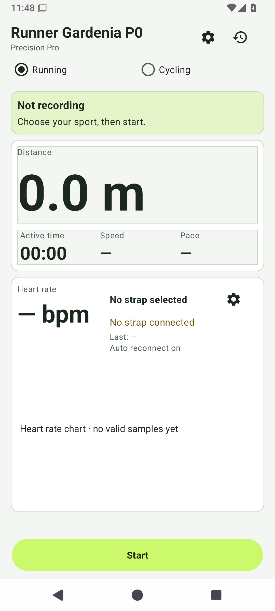
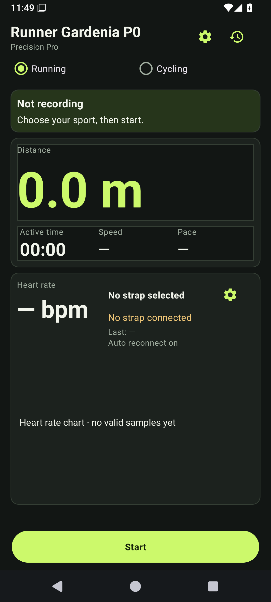
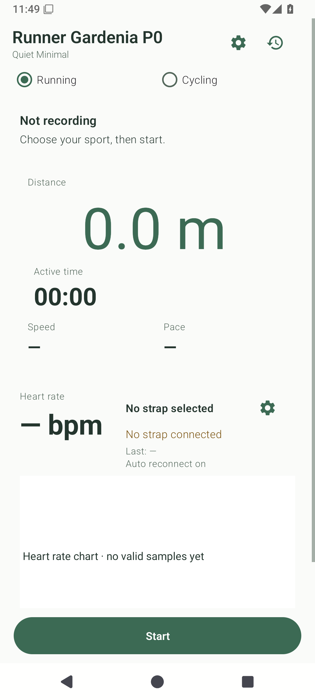
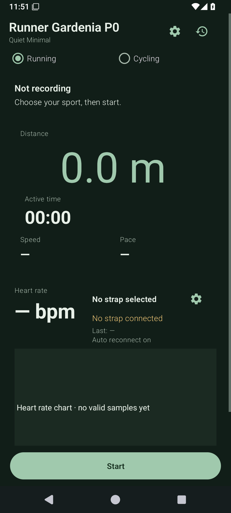
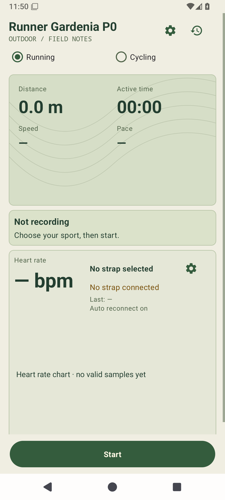
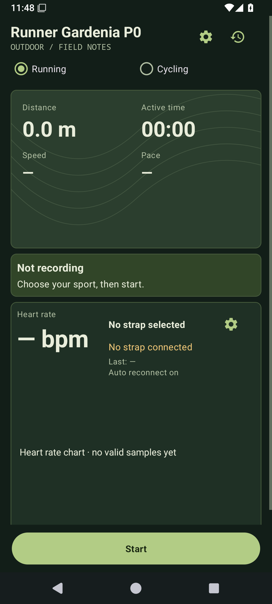
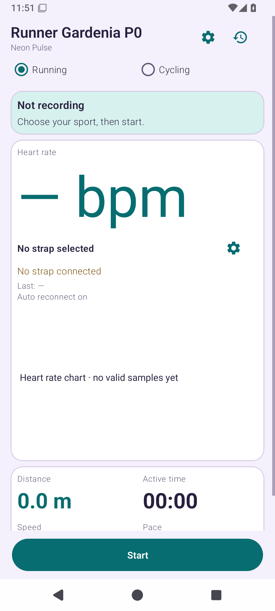
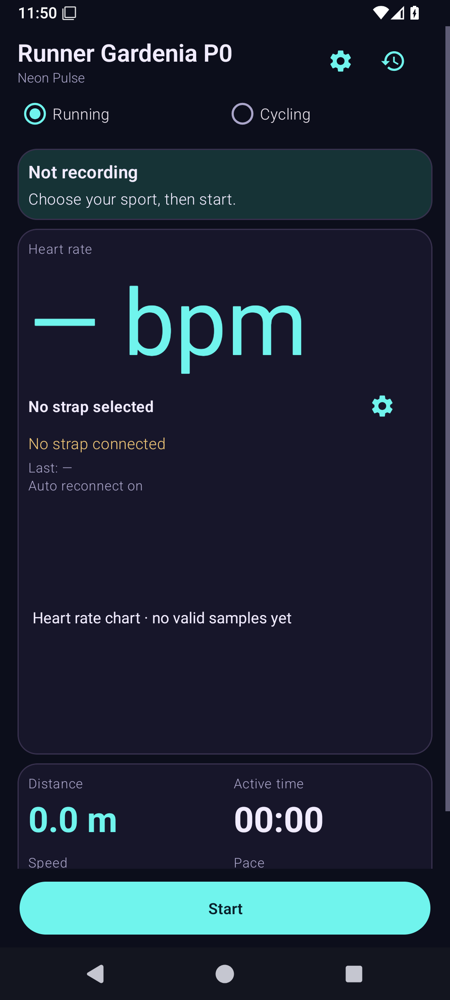

# 原生主题截图

所有 PNG 来自 API 35 原生应用；测试使用明确标记的合成 GPS / 心率通知，未使用 HTML 截图代替。

截图来源提交、各文件 SHA-256 和模式断言见 result.json。正式签名 APK 的独立截图另见 Release 的 theme-screenshots.zip。

| 家族 | Light 运动首页 | Dark 运动首页 |
|---|---|---|
| Precision Pro |  |  |
| Quiet Minimal |  |  |
| Outdoor Explorer |  |  |
| Neon Pulse |  |  |

每个家族及模式均保留 home、recording、heart、history、detail、dialog、settings 七页原始截图，共 56 张。

## 七页面原图索引

| 家族 / 模式 | 首页 | 记录 | 心率 | 历史 | 详情 | 弹窗 | 设置 |
|---|---|---|---|---|---|---|---|---|
| Precision Pro light | [home](p03-precision-light-home.png) | [recording](p03-precision-light-recording.png) | [heart](p03-precision-light-heart.png) | [history](p03-precision-light-history.png) | [detail](p03-precision-light-detail.png) | [dialog](p03-precision-light-dialog.png) | [settings](p03-precision-light-settings.png) |
| Precision Pro dark | [home](p03-precision-dark-home.png) | [recording](p03-precision-dark-recording.png) | [heart](p03-precision-dark-heart.png) | [history](p03-precision-dark-history.png) | [detail](p03-precision-dark-detail.png) | [dialog](p03-precision-dark-dialog.png) | [settings](p03-precision-dark-settings.png) |
| Quiet Minimal light | [home](p03-quiet-light-home.png) | [recording](p03-quiet-light-recording.png) | [heart](p03-quiet-light-heart.png) | [history](p03-quiet-light-history.png) | [detail](p03-quiet-light-detail.png) | [dialog](p03-quiet-light-dialog.png) | [settings](p03-quiet-light-settings.png) |
| Quiet Minimal dark | [home](p03-quiet-dark-home.png) | [recording](p03-quiet-dark-recording.png) | [heart](p03-quiet-dark-heart.png) | [history](p03-quiet-dark-history.png) | [detail](p03-quiet-dark-detail.png) | [dialog](p03-quiet-dark-dialog.png) | [settings](p03-quiet-dark-settings.png) |
| Outdoor Explorer light | [home](p03-explorer-light-home.png) | [recording](p03-explorer-light-recording.png) | [heart](p03-explorer-light-heart.png) | [history](p03-explorer-light-history.png) | [detail](p03-explorer-light-detail.png) | [dialog](p03-explorer-light-dialog.png) | [settings](p03-explorer-light-settings.png) |
| Outdoor Explorer dark | [home](p03-explorer-dark-home.png) | [recording](p03-explorer-dark-recording.png) | [heart](p03-explorer-dark-heart.png) | [history](p03-explorer-dark-history.png) | [detail](p03-explorer-dark-detail.png) | [dialog](p03-explorer-dark-dialog.png) | [settings](p03-explorer-dark-settings.png) |
| Neon Pulse light | [home](p03-neon-light-home.png) | [recording](p03-neon-light-recording.png) | [heart](p03-neon-light-heart.png) | [history](p03-neon-light-history.png) | [detail](p03-neon-light-detail.png) | [dialog](p03-neon-light-dialog.png) | [settings](p03-neon-light-settings.png) |
| Neon Pulse dark | [home](p03-neon-dark-home.png) | [recording](p03-neon-dark-recording.png) | [heart](p03-neon-dark-heart.png) | [history](p03-neon-dark-history.png) | [detail](p03-neon-dark-detail.png) | [dialog](p03-neon-dark-dialog.png) | [settings](p03-neon-dark-settings.png) |

[最终签名 APK 页面/XML 验收](signed/README.md)和[大字体窄屏原图](font130/manifest.json)另外保留；所有文件均来自实际 API35 应用。
