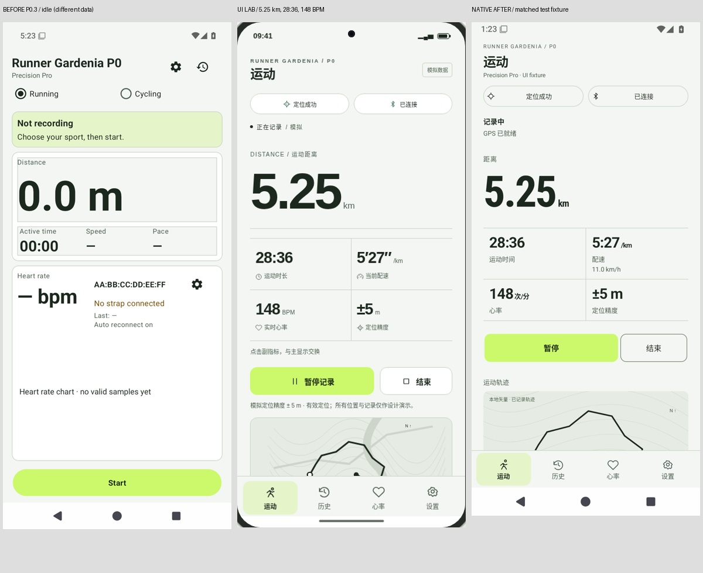
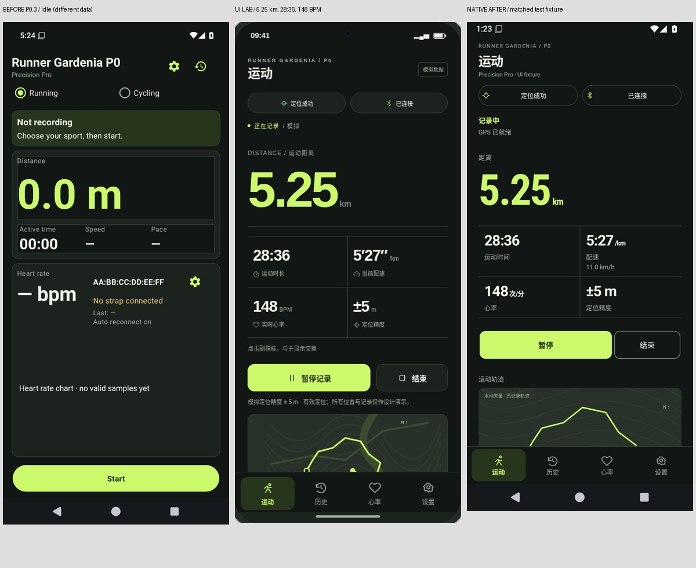
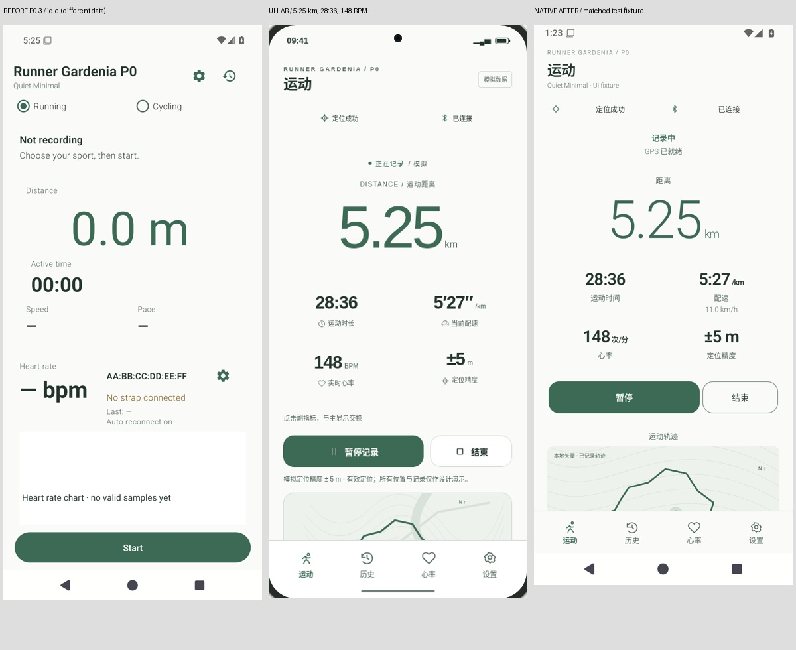
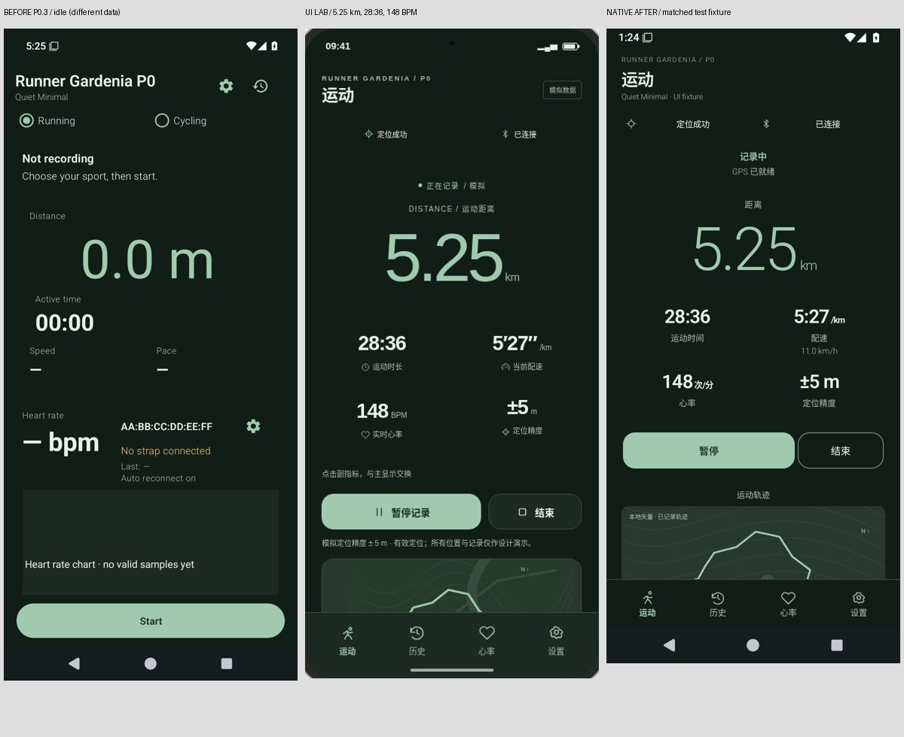
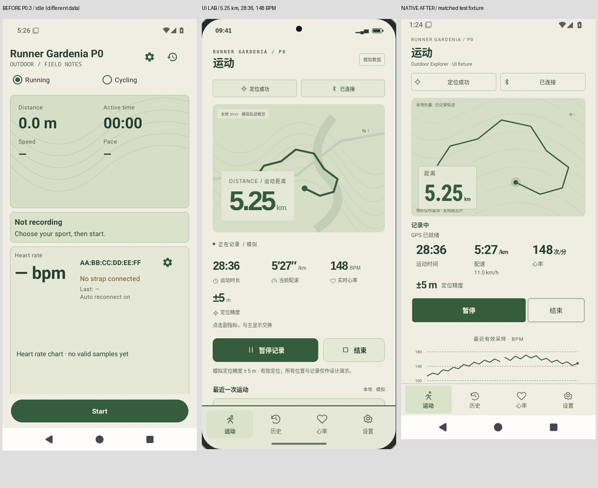
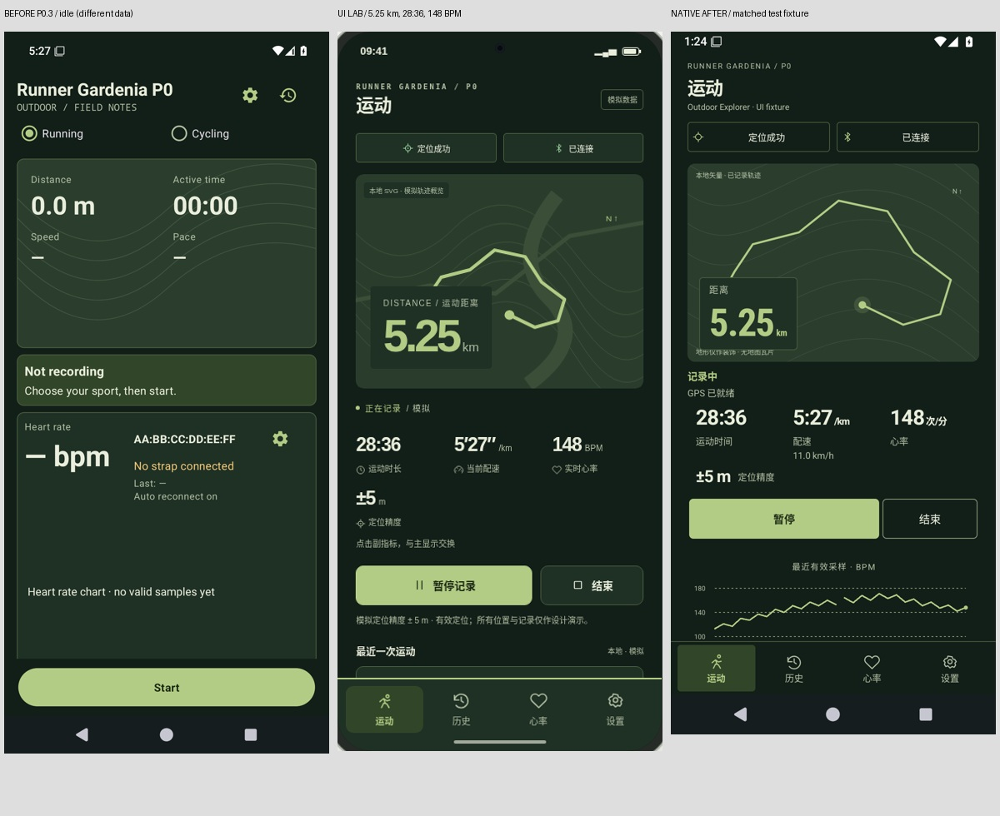
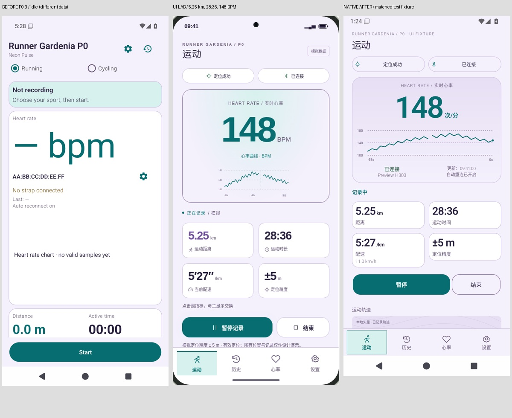
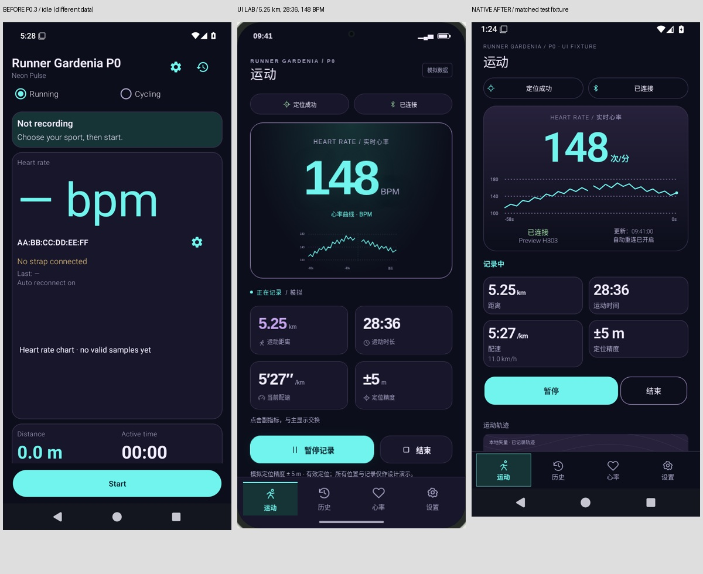

# P0.3 原生 UI 深度还原交付

完成版本：`v0.1.0-p0.4` / `6775`。包名 `com.fox.runner`，原固定签名。

[测试 Pre-release](https://github.com/foxmaybeOI1761640545/Runner_Gardenia-06/releases/tag/test-p0-v0.1.0-p0.4) · [APK](https://github.com/foxmaybeOI1761640545/Runner_Gardenia-06/releases/download/test-p0-v0.1.0-p0.4/RunnerGardenia-P0-Release.apk)

APK SHA-256：`aa5ebc21c76cbca492edc66453b91d7fdecaf82bd5a69fcab208c740b4224ebc`

APK：2803864 bytes；Certificate SHA-256：`E3E7D46BFCB869F5A521A7FBA6FD1BA5790D7DBCAF37F722DDC69D7BB1439A22`。

源码：`ccc59b546b5087a2038d32087cc675a3096852c3`；完整测试 Run `42504187574`；签名构建 Run `42506398467`；构建 workflow commit `8f4576090864d30f6a9152d74e750bb06646e87f`。

## 原生问题与重构结果

旧版本以共享大卡片为主体：巨大的距离单位、220dp 心率空区、突出 MAC、Outdoor 仅装饰背景、Neon 空占位占屏、顶部重复导航。详细问题与原型/旧包原图见 [视觉差距分析](VISUAL_GAP_ANALYSIS.md)。

| 家族 | 实际原生改造 | Light / Dark |
|---|---|---|
| Precision Pro | 距离焦点、精密分隔线 2×2 网格、小单位、清晰数字层级、真实轨迹与紧凑心率细节 | 均通过 |
| Quiet Minimal | 中心大数字、开放无卡框指标、自然间距、轻字重、透明状态控件 | 均通过 |
| Outdoor Explorer | 238dp 轨迹主视觉、真实位置/路径/分段、本地装饰地形、距离覆盖层、三列指标 | 均通过 |
| Neon Pulse | 有效 BPM 视觉中心、84dp 原生真实采样曲线、紧凑设备元信息、2×2 次指标、专属操作表现 | 均通过 |

[实现说明](IMPLEMENTATION.md) · [修改文件清单](CHANGED_FILES.json)。Java/XML/ViewBinding/原生 Canvas；一套业务状态与命令，四个独立 XML 组织。GPS/BLE/状态机/数据库/GPX 算法及八套配色 Token 保持基线不变。

## 心率、轨迹、导航与系统外观

心率缺失值保持适当大小；无采样只有网格与说明，不绘制假波形。设备名称、状态、更新时间与真实采样保留，MAC 留在设备设置。轨迹只读现有实际 trackpoints，保留时间/分段断点，地图标明地形仅为本地装饰、无地图瓦片；没有 GPS 时有明确空状态。

底部四个目的地均为已有真实功能：运动、历史、心率、设置。操作位于滚动内容、导航独立，不覆盖；至少48dp触摸目标。主题家族持久化，Light/Dark 固定跟随 Android 系统，不要求重启；Activity/ViewModel/服务状态回归验证覆盖页面、记录、GPS 和连接标识。

## 原图与前后对照

[192 张原生预览截图索引与 SHA-256](screenshots/manifest.json)：四家族 × 两种真实系统模式 × 360×800 / 390×844 / 412×915 dp × 八状态。5.25km /28:36 /5:27/km /148BPM 的固定数据只在 Debug/androidTest；实际 Release 使用真实业务数据。

优化前原生包为空闲状态，不能用其数值与记录态评分；UI Lab 与新原生主要截图使用匹配数据。下列三列组合图是供比较的派生图，原始 PNG 及 provenance 完整保留。用户八张内嵌附件已逐张参考，未获得附件二进制 ID 的情况见 [参考来源说明](../ui-reference/README.md)。

### Precision Pro

[相同空闲/无心率状态对比 Light](comparisons/precision-light-idle.jpg) · [Dark](comparisons/precision-dark-idle.jpg)

### Quiet Minimal

[相同空闲/无心率状态对比 Light](comparisons/quiet-light-idle.jpg) · [Dark](comparisons/quiet-dark-idle.jpg)

### Outdoor Explorer

[相同空闲/无心率状态对比 Light](comparisons/explorer-light-idle.jpg) · [Dark](comparisons/explorer-dark-idle.jpg)

### Neon Pulse

[相同空闲/无心率状态对比 Light](comparisons/neon-light-idle.jpg) · [Dark](comparisons/neon-dark-idle.jpg)

## 自动化与真实安装验收

- Android Instrumentation：407 项，406 实际执行，失败 0、错误 0、原有跳过 1。
- JVM：118 实际通过；Python 发布/门禁帮助测试 77 项实际通过，计数来自 Actions 原始日志。
- 真实 API35 八配色/三尺寸/八状态原生矩阵、系统模式、页面/运动/GPS/连接状态保留、原有 56 张主题页面回归（原 PNG 在完整测试 Artifact，结果索引保存在本分支）、36 张首页状态回归及上游心率 UI 回归。
- 360dp 窄屏与130%字体、至少48dp触摸目标、无水平溢出/文本截断；图表与导航可访问语义。
- 实际 GPX 九类文件校验 GPX1.1；两个不同 instrumentation 进程与 force-stop 数据持久性；Release offline manifest 与私有 GPX provider 审计。
- 签名 APK 实际安装，从 P0.3 code6774 保留数据覆盖：保留 GPS 点 1、原始心率采样 2；实际新 GPS 录制、暂停/继续、强停恢复与 GPX 导出已验证。
- 正式签名包另有32张真实原生页面 PNG/XML，覆盖八配色×运动/历史/心率/设置，检查当前窗口、原生页面与16项实际背景像素；重启后主题保持。
- APK package/version/signature/zipalign/R8/resource optimization 已验证；每个 Draft asset 下载逐字节核对后发布，公开 APK 再匿名下载并核对构建 Artifact SHA-256、版本和固定证书。

[完整测试收据](receipts/full-tests.json) · [签名构建](receipts/build-info.json) · [覆盖升级/运动/导出](receipts/upgrade-runtime.json) · [32 张正式包原生截图](screenshots/signed-apk/native-theme-matrix.json) · [公开下载证明](receipts/publication.json)。

## 视觉门禁与失败保留

自动化通过不能代替逐图比较。三轮视觉拒绝、中文上下文修正、全新 AVD 首次 Launcher 等待和 Outdoor 360dp 触摸边界失败均保留在 [iterations](iterations/) 与 [failures](failures/)。相关失败修复后重测；没有放松断言、移动旧 Tag、替换旧 Release 或把网页图冒充原生图。最终实际截图复核见 [VISUAL_REVIEW.md](VISUAL_REVIEW.md)。

## 基线与范围

开发分支 `feature/theme-system-p0-3-ui-refinement`；基线完成的 P0.3 `cebf4682cec672fbde022c54bda3b442ff0663ab`。旧发布 APK 源 `77ef053b76fd5e7c6c0c9ce1023e365fa3d7c471`。仅新分支接收本轮代码与报告；现有设计站点、旧开发分支、Tag 和 Release 保持冻结，没有重新执行网站 Phase1 或历史资料归档。

## 尚需真实设备验收

API35 模拟器与合成 GPS/SIG 输入验证了软件路径，不能替代实体 H303 射频连接、户外 GNSS、耗电及人工 TalkBack 语音体验。Android8+ minSdk/资源与签名兼容检查已做；本轮运行环境是 API35，未取得实体手机或 API26 运行截图。网页/原生字体渲染、原生系统栏和48dp目标会有合理差异，不宣称逐像素等同网页。

## 公开下载与证据索引

发布 Actions [42507576738](https://github.com/foxmaybeOI1761640545/Runner_Gardenia-06/actions/runs/42507576738) 成功；Release ID `438419806`，为非 Latest 的测试 Pre-release。云端匿名公共资产 API 与工作区独立浏览器下载 URL（`?download=1`）两条下载路径均成功；独立检查八个附件 HTTP200/大小/SHA-256，APK 与 Formal Artifact 字节完全相同并重新验证 APKv2 数字签名、内容摘要、包名及版本。

- [独立公开下载和签名复核](receipts/independent-public-download.json)
- [旧分支与 Tag 冻结、唯一新 Tag 源码指向及 Release 元数据](receipts/remote-refs-and-release.json)
- [原始 Android/JVM JUnit XML](receipts/junit/)
- [原始签名、优化任务与合并 Manifest](receipts/signed-apk-verification/)
- [发布测试汇总，含77项辅助测试](receipts/test-summary.json)

完整测试 Artifact `13626853039`：`P04-reports-42504187574`，ZIP SHA-256 `9b0686f11a9fe0d24e70738a8732ea460b9380af5ce50cb4fde6f7befd077cba`，保留原始全量HTML/图片/测试报告。签名诊断 Artifact `13628270849`：`P04-Release-reports-42506398467-1`。分支内另永久保存192张最终夹具原生PNG、32张正式APK原生PNG及其窗口XML、原型和旧APK原图、16张前后组合图、拒绝迭代截图与原始测试XML。未将APK或密钥写入Git。
