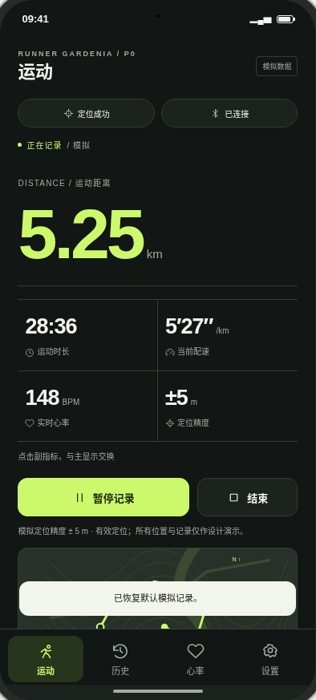
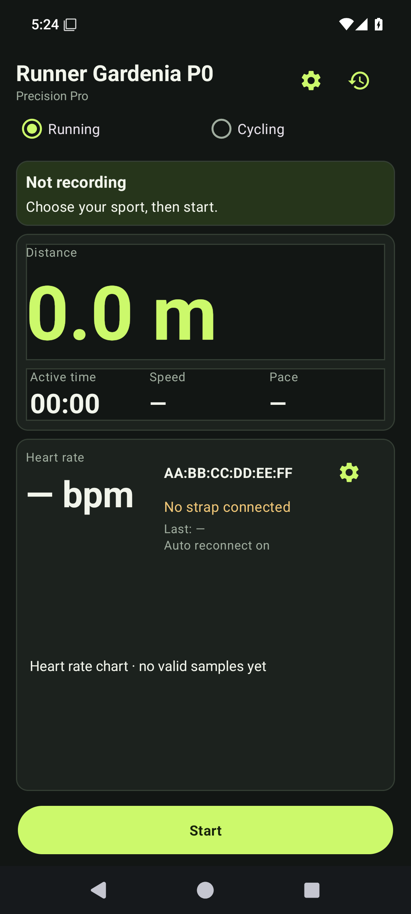
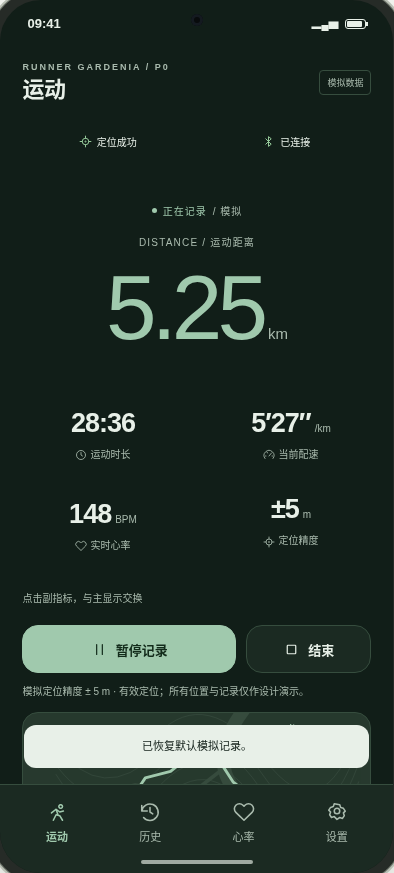
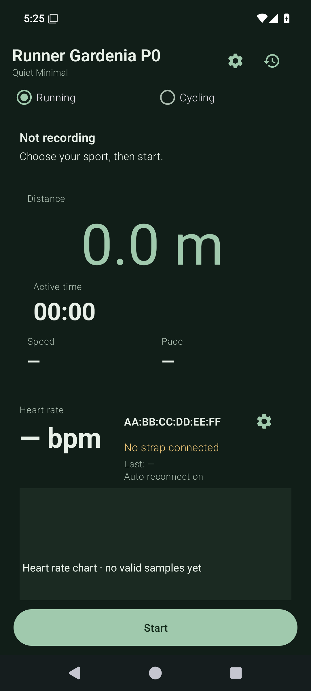
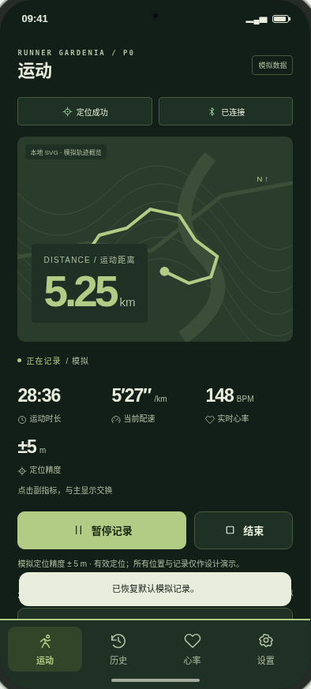
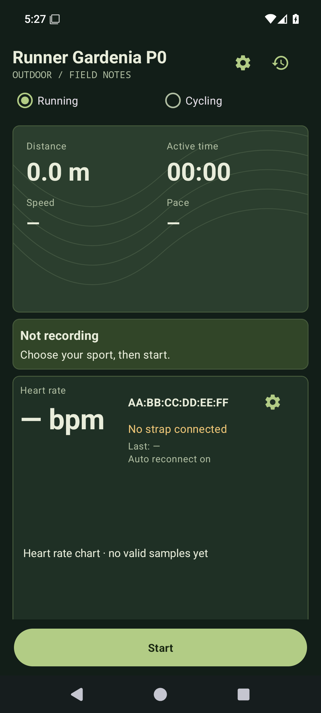
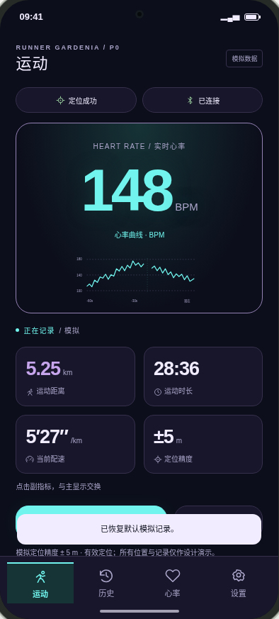
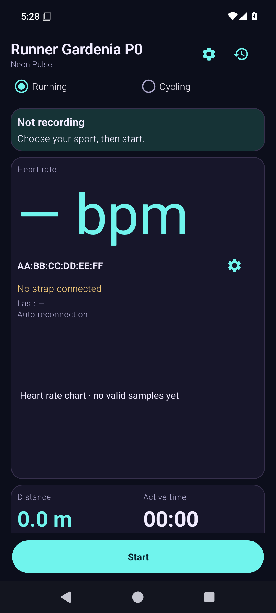

# P0.3 原生 UI 视觉差距分析

本报告在修改 Android 产品代码前形成。基线为已完成的 P0.3 开发 HEAD `cebf468`，原 APK 源码 `77ef053`，新工作分支 `feature/theme-system-p0-3-ui-refinement`；不是 P0.2。所有旧分支、Tags、Releases、网站均冻结。

## 参考与方法

逐张查看用户的四张 UI Lab 图和四张中文实际手机图，并读取线上应用内屏、`ui-lab/app.js` 的 `hero / dataGrid / statusRow / route / renderNav` 与四家族 CSS。可复核的八套内屏与八套旧原生原图保存在 [ui-reference](../ui-reference/README.md)。本轮不是网页 Phase 1 重跑。

原型使用记录中，用户实际图多为结束/未连接且数值不同。首先识别与数据无关的结构问题；新原生图与网页另用相同的 5.25 km / 28:36 / 5′27″ / 148 BPM / GPS 定位 / BLE 连接进行比较。测试数据只能在 androidTest 中注入只读 UI 表现层，不写入生产代码的业务数据源。

## 共同根因

上一轮四份 XML 的主次排列已经有差别，但共同骨架仍是大标题、同一双单选模式、状态卡、指标卡、心率卡、固定操作栏。共享的是整块高占比容器，而不是小型组件；图表固定 `220dp`，使未连接状态也占一块完整面板。字号把 BPM 数字和本地化单位放在同一巨大 TextView 中。`status.device()` 和已选 MAC 被直接填到主界面。Outdoor 的等高线只是 `gardenia_terrain` Drawable，没有读取 TrackPoint；Neon 没有原型 80px 的紧凑波形主体。顶部设置/历史入口与原型四目的地底栏不一致。原来测试检查了状态、颜色和截图生成，但缺少原型结构和相同数据的视觉门禁。

UI 与业务边界：保留 P0RecordingViewModel、TrackRecordingService、GPS/BLE 驱动、SessionStore、数据库、GPX。新增只读轨迹投影、紧凑图表、统一导航与显示模型。四套布局独立组织，共享读取/格式化/命令路径；Light/Dark 不切换布局文件。

## Precision Pro

| UI Lab 手机内屏 | 当前已发布 Android |
|---|---|
|  |  |

| 检查项 | 实际差距 | 实施方向 |
|---|---|---|
| 布局 | 原型是左对齐距离主读数、2×2 精密网格、操作、轨迹；旧版把距离塞进大框，下方是大心率面板。 | 拆掉大距离卡和通用心率卡，恢复带细分隔线的数字层级；轨迹独立放在操作后。 |
| 组件 | 缺少 GPS/BLE 状态胶囊、地图/轨迹、四目的地底栏；顶部两个独立图标过重。 | 原生状态按钮、四指标网格、Canvas 轨迹和实际底部导航。 |
| 字体与字号 | 旧大标题与整个「0.0 m」「— 次/分」抢占焦点；原型主数字与单位分级。 | 品牌小字、页面标题、距离主数字、单位小字、次指标明确分级；保留等宽数字特征。 |
| 间距 | 220dp 图表加大框/内边距造成无效空白与长滚动。 | 紧凑栅格、横线对齐；图表按语义缩为短条，不以空白撑高。 |
| 颜色和对比度 | Token 基本一致，但整块卡背景削弱原型石墨底与绿色数字的层级。 | 沿用八套 Token，减少大面积填充，强调与正文分别使用语义色。 |
| 信息层级 | 品牌标题、巨大单位和设备 MAC 与运动距离竞争。 | 距离第一、四项数字第二、连接/来源信息第三；MAC 只留设备设置。 |
| 缺失功能性视觉 | 没有实际路径、当前位置、底栏选中态。 | 读取已记录轨迹、实际定位点；无轨迹时显示清晰空地图，不伪造路线。 |

需要重构：`res/layout/gardenia_home_precision.xml`、`p0_home.xml` 绑定契约、`P0Activity.java` 显示层、`PreviewChartModel.java`；共享新增 `DashboardRenderer / RouteMapView / RoutePreviewModel / PulseChartView / P0Navigation`，并调整三目的地根布局。GPS/BLE/记录/数据库/GPX 核心不修改。

## Quiet Minimal

| UI Lab 手机内屏 | 当前已发布 Android |
|---|---|
|  |  |

| 检查项 | 实际差距 | 实施方向 |
|---|---|---|
| 布局 | 原型居中距离与开放的两列指标；旧版是偏左的纵向数值、巨大间隔和底部心率空板。 | 居中距离、成组两列排版；用节奏与细线组织，不套卡片模板。 |
| 组件 | 旧版继承心率卡和相同头部快捷按钮。 | 无边框状态、开放心率行、短图表、轻量实际底栏。 |
| 字体与字号 | 旧空白与字号比例没有对应原型轻字重距离/次指标层级。 | 主数字轻字重、单位小号，次指标中等字重，标签弱化但保持可读。 |
| 间距 | 读数之间跨度过大，整屏没有有效节奏；未连接仍撑起大面板。 | 使用分组的 12/20/28dp 节奏，空图表保持短小。 |
| 颜色和对比度 | 森林绿深色正确，表面矩形造成额外视觉块。 | 沿用 Light/Dark 资源，开放区域直接用背景，文本/分隔线维持对应对比。 |
| 信息层级 | 结束说明与 MAC 过重，距离与速度/配速分组不清。 | 距离居中主导，运动时长/配速并列，心率与精度成为第二组。 |
| 缺失功能性视觉 | 没有原型底栏、下方真实路径概览。 | 原生底栏与低干扰轨迹区，空状态不制造数据。 |

需要重构：`res/layout/gardenia_home_quiet.xml`、`p0_home.xml` 绑定契约、`P0Activity.java` 显示层、`PreviewChartModel.java`；共享新增 `DashboardRenderer / RouteMapView / RoutePreviewModel / PulseChartView / P0Navigation`，并调整三目的地根布局。GPS/BLE/记录/数据库/GPX 核心不修改。

## Outdoor Explorer

| UI Lab 手机内屏 | 当前已发布 Android |
|---|---|
|  |  |

| 检查项 | 实际差距 | 实施方向 |
|---|---|---|
| 布局 | 原型地图在上、距离叠层、三列运动指标；旧版地图位置是装饰背景上的四个数字。 | 地图先行；距离浮层覆盖地图，时长/配速/心率置于地图下，其他字段分层。 |
| 组件 | 只有矢量等高线背景，没有轨迹、定位点、比例或数据来源说明。 | 原生 Canvas 轨迹/当前位置/起点、可见装饰等高线、非地图瓦片来源标签。 |
| 字体与字号 | 原型户外小字与距离叠层；旧版数字分散在地形卡中。 | 户外等宽小标题、距离叠层、紧凑三列信息。 |
| 间距 | 装饰卡占据大高度而不承担地图功能，下方继续堆大心率卡。 | 地图高度服务轨迹，底部保留操作及底栏；不再额外堆通用心率大卡。 |
| 颜色和对比度 | 自然色方向正确，轨迹不存在，数据与等高线难区分。 | 背景地形降低对比，真实轨迹用清晰强调线；Light/Dark 使用对应资源。 |
| 信息层级 | 旧版无法识别“路线优先”，更像绿色仪表盘。 | 路线第一、距离叠层第二、实时指标第三，状态明确。 |
| 缺失功能性视觉 | 未读取 TrackPoint，无有效位置/缺失段/暂停段语义。 | 后台只读已存路径，绘制时按分段/间隔断线；显示实际有效当前位置；无数据不画假地理路线。 |

需要重构：`res/layout/gardenia_home_explorer.xml`、`p0_home.xml` 绑定契约、`P0Activity.java` 显示层、`PreviewChartModel.java`；共享新增 `DashboardRenderer / RouteMapView / RoutePreviewModel / PulseChartView / P0Navigation`，并调整三目的地根布局。GPS/BLE/记录/数据库/GPX 核心不修改。

## Neon Pulse

| UI Lab 手机内屏 | 当前已发布 Android |
|---|---|
|  |  |

| 检查项 | 实际差距 | 实施方向 |
|---|---|---|
| 布局 | 原型心率数字+短波形是一个紧凑视觉中心，再接 2×2 次指标；旧版一个巨大的单位占位符和空面板。 | 心率主体居中，真实 BPM 大数字，空读数主动缩小；短波形与坐标网格紧随其下。 |
| 组件 | 缺少清晰波形；设备 MAC 仍在主视觉，空态只有文字。 | 有实际样本时绘制青色折线与新样本反馈；空态画网格和说明，提供连接入口。 |
| 字体与字号 | 中文「次/分」与数字同号，未连接破折号比有效数据还突出。 | 数字/单位使用独立视觉字号；有效 BPM 强调，未连接与无采样状态缩小。 |
| 间距 | 220dp 图表加大字号将距离/时长压到屏幕之外。 | 主卡高度由数据内容+短图表构成，次指标四格与操作保持自然排列。 |
| 颜色和对比度 | 紫/青方向正确，缺少克制光晕、边线和波形层次。 | 沿用语义色，原生渐变/描边与少量真实样本更新反馈；浅色版同时验证。 |
| 信息层级 | 当前无效占位符压过运动数据，实时数据反而缺乏焦点。 | 新鲜有效 BPM 第一、真实曲线第二、运动指标第三；无样本清楚说明不伪装实时波形。 |
| 缺失功能性视觉 | 没有可辨识的脉冲区与断线语义，原型底栏缺失。 | 只显示真实采样、缺口断线、短图表和四目的地导航。 |

需要重构：`res/layout/gardenia_home_neon.xml`、`p0_home.xml` 绑定契约、`P0Activity.java` 显示层、`PreviewChartModel.java`；共享新增 `DashboardRenderer / RouteMapView / RoutePreviewModel / PulseChartView / P0Navigation`，并调整三目的地根布局。GPS/BLE/记录/数据库/GPX 核心不修改。

## 连续实施与验收门禁

按 Precision → Quiet → Explorer → Neon 实施，之后收敛心率和导航。每个家族的两种系统模式使用同一结构。API35 原生截图覆盖 360×800、390×844、412×915dp；统一记录中数据，另覆盖 idle、acquiring、fixed、paused、finished、disconnected、connected-no-sample。截图、窗口层级、业务回归分别验收；视觉不合格就继续修改。图像生成工具或 HTML 渲染不能代替原生截图。开发与原生视觉通过后，才允许固定密钥的新版本签名、安装/升级、公开下载和 SHA-256 复核。旧 Release 不改动。
