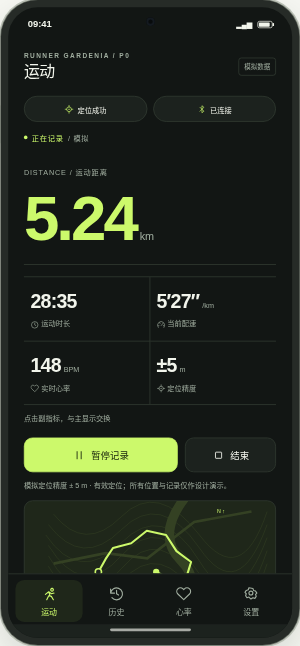
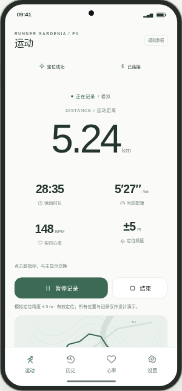
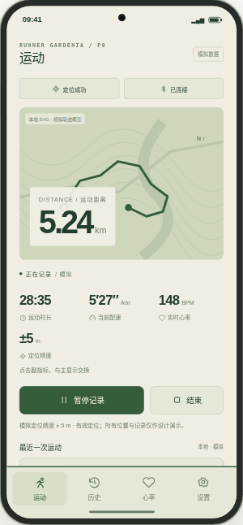
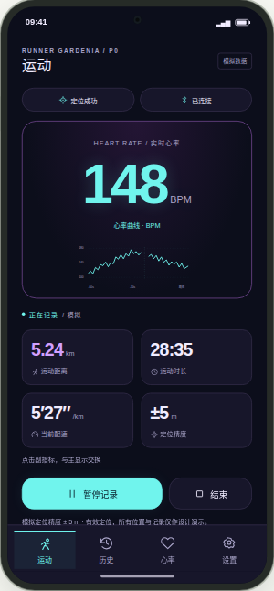
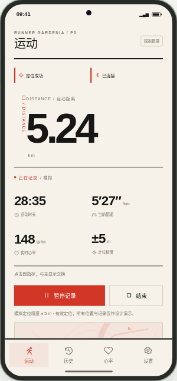
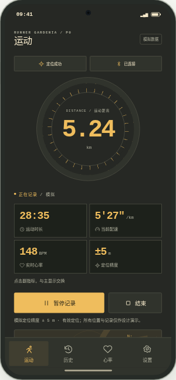
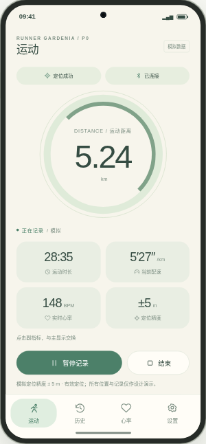
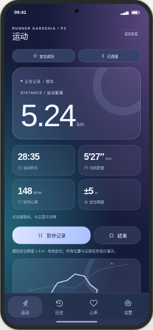
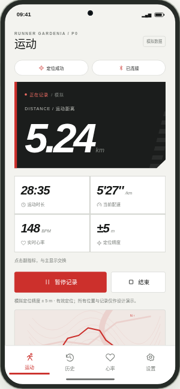
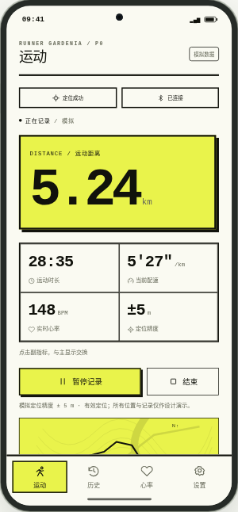

# 实际浏览器截图

本站真实运行后的截图，已取回并审查，来源为正式 Pages 全量浏览器验收 [GitHub Actions 42353043971](https://github.com/foxmaybeOI1761640545/Runner_Gardenia-06/actions/runs/42353043971)，源码 `6fd9c73a5b90109db757bfbe0299729ef8df6759`，Chrome `156.0.8078.79`。

新增 [十套主题交换与长时长截图](metric-swaps/README.md)，共 20 张，来源与哈希单独记录。

- `theme-01.png` 至 `theme-10.png`：同一模拟记录状态的十套完整手机界面，截图时浏览器视口 1440×1000，手机按网站规则等比缩放。
- `desktop-1440.png`、`desktop-1366.png`、`mobile-390.png`：1440×1000、1366×768、390×844 视口的整页截图；整页图片高度可以大于视口高度。
- [PROVENANCE.json](PROVENANCE.json) 记录截图 SHA-256、尺寸、浏览器版本、来源提交与运行链接。
- 每次 CI 验收成功后重新捕获当前版本并更新其部署包中的来源记录；仓库保留此处已审查的归档快照。不会将网上图片或生成图片用作界面截图。
- 可下载后打开 [对比画廊](index.html)，或运行网站在下方轮播中查看。

| 01 Precision Pro | 02 Quiet Minimal |
|---|---|
|  |  |
| 03 Outdoor Explorer | 04 Neon Pulse |
|  |  |
| 05 Swiss Editorial | 06 Industrial Gauge |
|  |  |
| 07 Calm Wellness | 08 Aurora Glass |
|  |  |
| 09 Racing Performance | 10 Data Brutalism |
|  |  |
