# 主副交换实际截图

来自正式 Pages 浏览器验收：[6fd9c73](https://github.com/foxmaybeOI1761640545/Runner_Gardenia-06/actions/runs/42353043971)，Chrome 156.0.8078.79。全部为实际网页截图；未合成或替换界面。尺寸与 SHA-256 见 [PROVENANCE.json](PROVENANCE.json)。

第二列为通过点击副指标将运动时长放入主区域；第三列通过原有模拟计时推进至 01:25:30 后截图。

| 主题 | 时长主显示 | 超过一小时 |
|---|---|---|
| 01 Precision Pro | 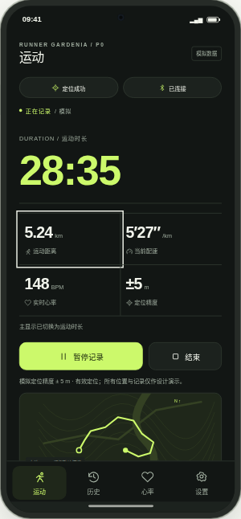 | 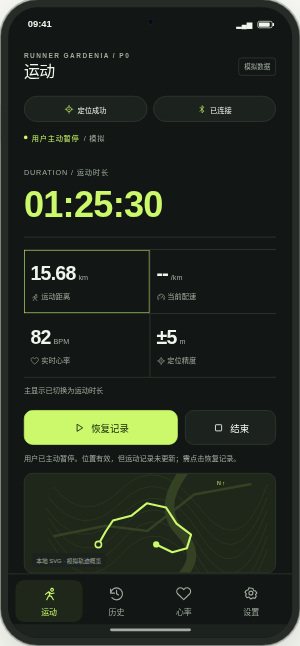 |
| 02 Quiet Minimal | 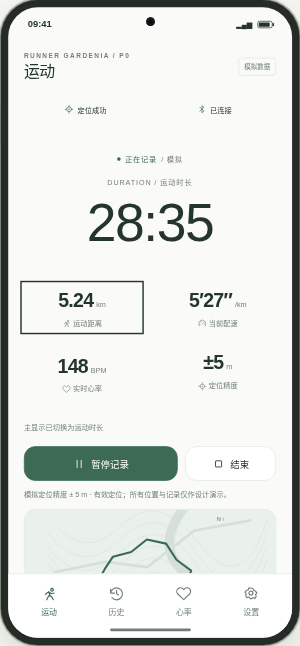 | 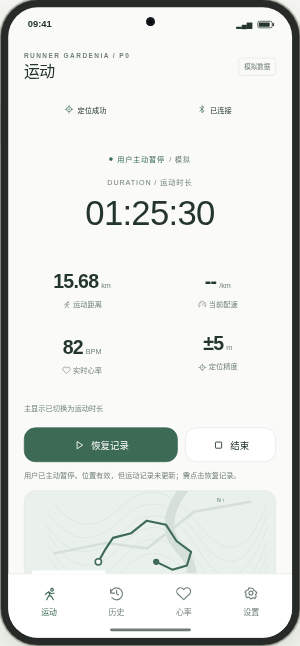 |
| 03 Outdoor Explorer | 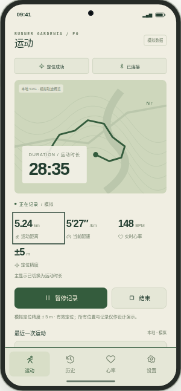 | 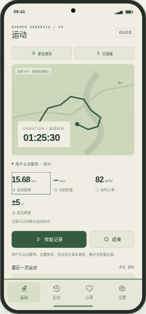 |
| 04 Neon Pulse | 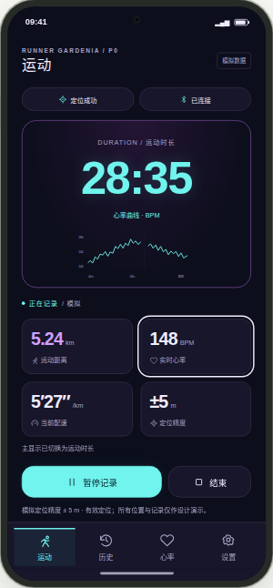 | 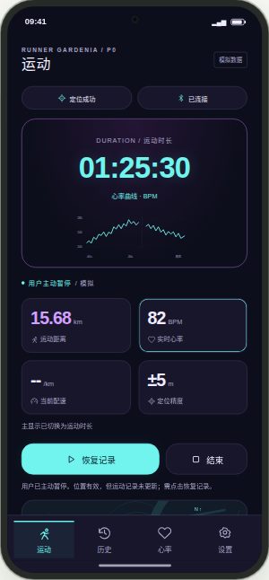 |
| 05 Swiss Editorial | 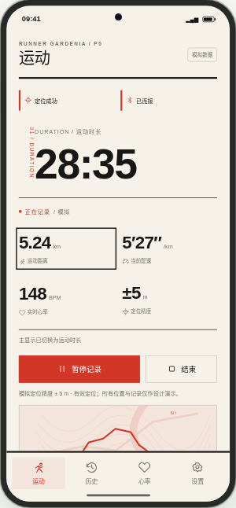 | 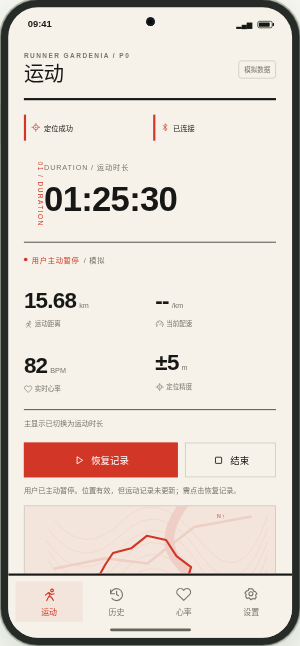 |
| 06 Industrial Gauge | 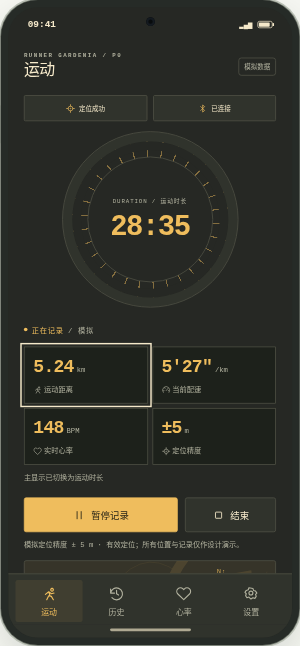 | 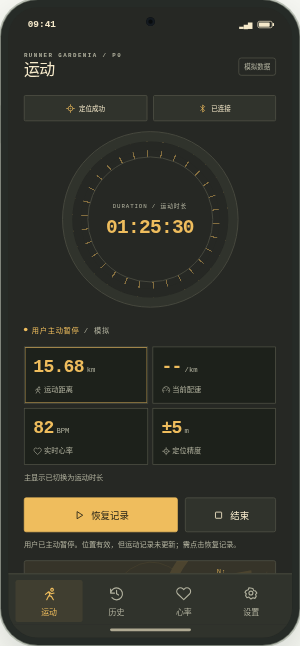 |
| 07 Calm Wellness | 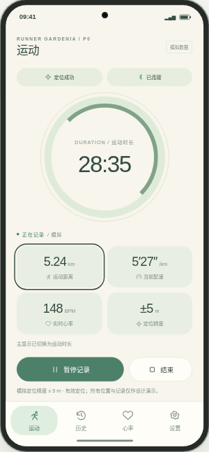 | 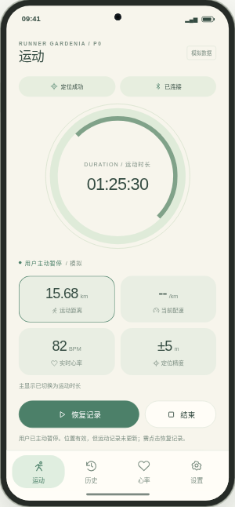 |
| 08 Aurora Glass | 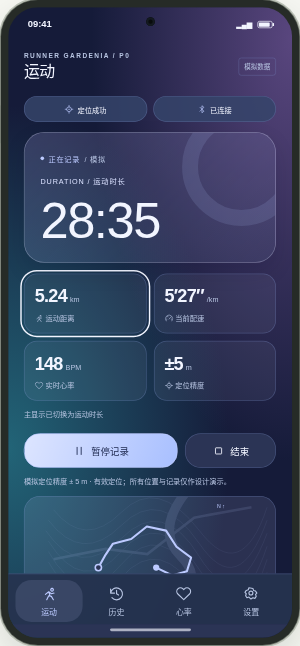 | 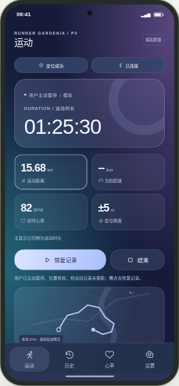 |
| 09 Racing Performance | 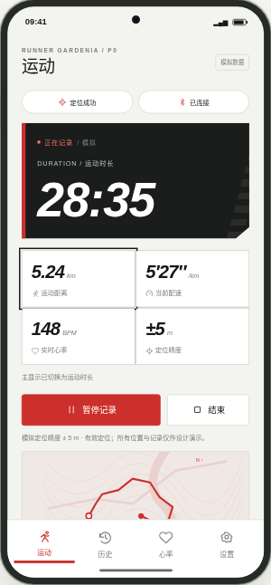 | 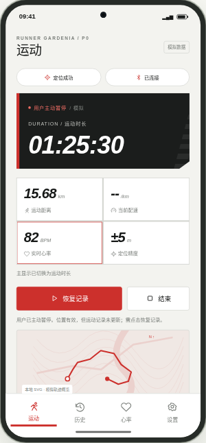 |
| 10 Data Brutalism | 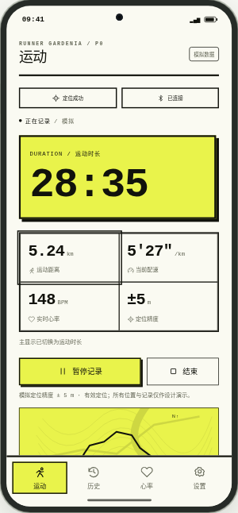 | 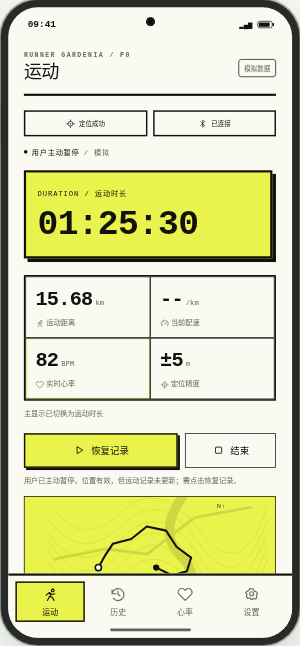 |
